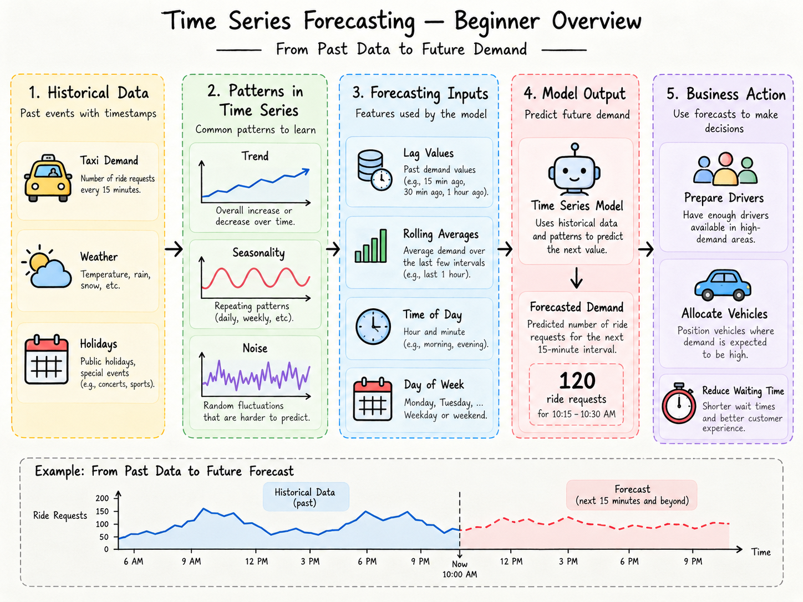
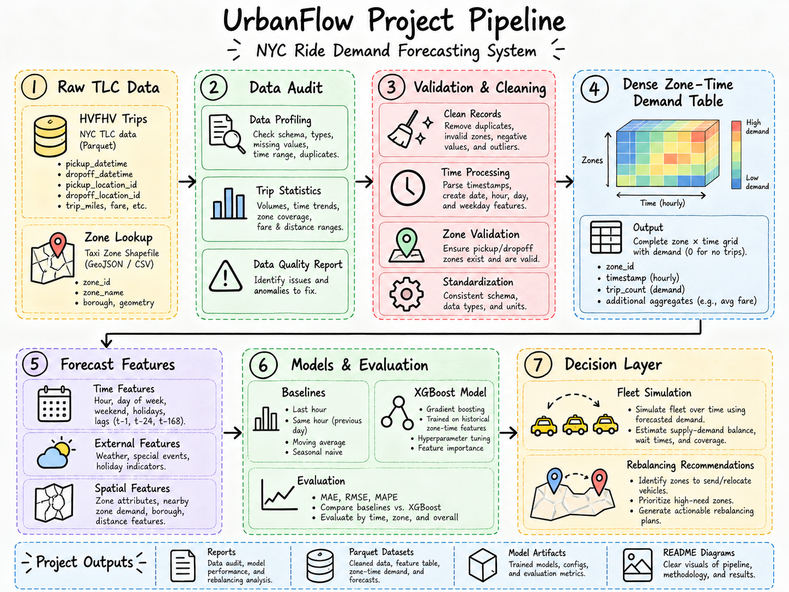
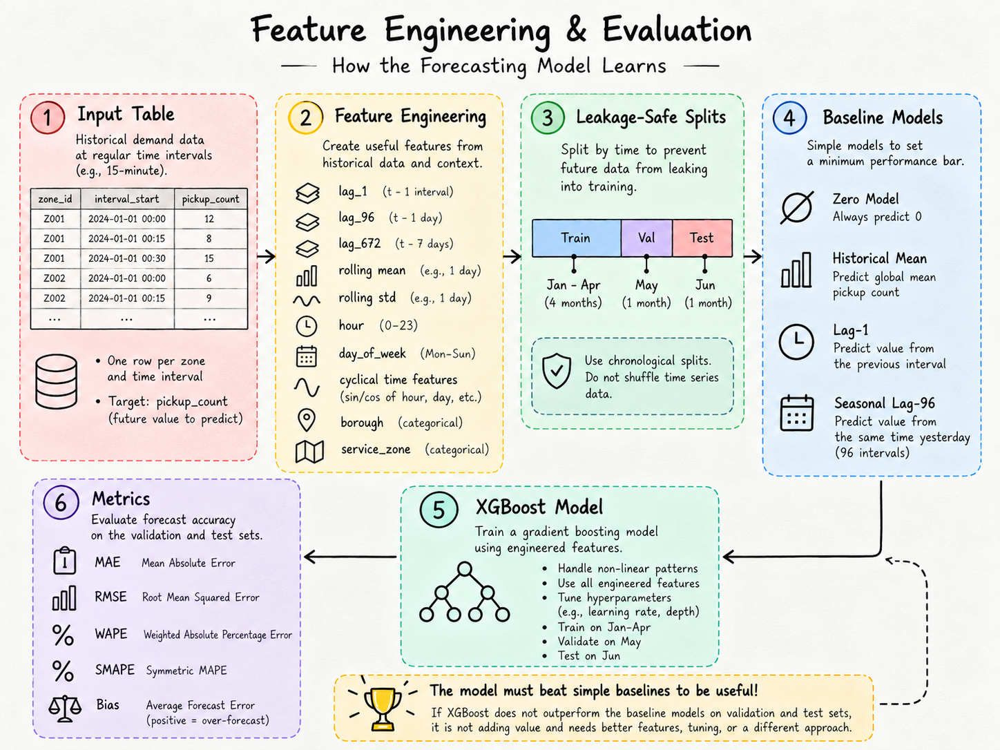
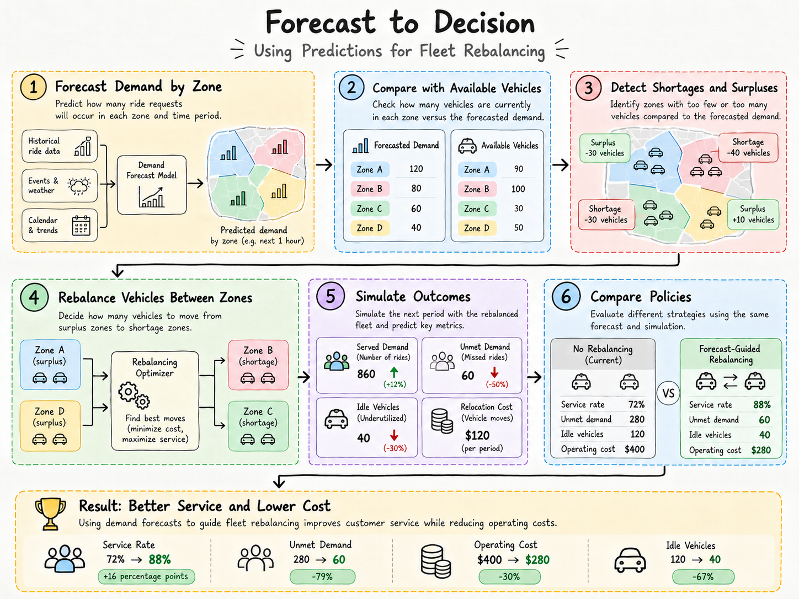

# UrbanFlow Control

**Forecast-Aware Fleet Rebalancing for NYC Ride Demand**

UrbanFlow Control is an end-to-end AI engineering project that turns **time-series demand forecasts into operational fleet-rebalancing decisions**.

The project starts with more than **120 million NYC High Volume For-Hire Vehicle pickup events**, builds a leakage-safe 15-minute demand forecasting pipeline, evaluates strong forecasting baselines against XGBoost, simulates vehicle supply across city zones, and measures whether forecast-guided rebalancing actually improves service.

> The goal is not only to predict demand.  
> The goal is to use predictions to make better operational decisions.

---

## Project at a Glance

```text
NYC HVFHV Trip Data
        │
        ▼
Data Validation & Auditing
        │
        ▼
Zone × 15-Minute Demand Table
        │
        ▼
Leakage-Safe Feature Engineering
        │
        ▼
Demand Forecasting
Baselines → XGBoost
        │
        ▼
Historical OD Network
        │
        ▼
Fleet Simulator
        │
        ▼
No-Rebalancing Baseline
        │
        ▼
Forecast-Guided Rebalancing
        │
        ▼
Operational Evaluation
```

---

# 1. What Is Time Series Forecasting?

Time series data is data collected in chronological order.

Examples include:

- taxi demand every 15 minutes,
- electricity consumption every hour,
- website traffic every day,
- product sales every week,
- stock prices every minute.

The objective of forecasting is simple:

```text
Past observations
        +
Patterns over time
        +
Context
        ↓
Prediction of future values
```

For UrbanFlow, the forecasting question is:

> **How many ride requests will occur in each NYC zone during the next 15-minute interval?**



A time series may contain several important patterns:

- **Trend** — long-term increase or decrease.
- **Seasonality** — repeating daily, weekly, or yearly behavior.
- **Lag dependence** — recent values help predict future values.
- **Noise** — random variation that cannot be perfectly predicted.

UrbanFlow converts these patterns into features that machine-learning models can learn from.

---

# 2. UrbanFlow End-to-End Pipeline

The project uses public NYC Taxi & Limousine Commission **High Volume For-Hire Vehicle (HVFHV)** trip records.

The current forecasting dataset covers:

```text
Period:          January – June 2024
Total pickups:   120,859,803
Taxi zones:      262
Time resolution: 15 minutes
Dense rows:      4,576,616
```

The pipeline transforms raw trip records into a clean zone-level time series.



The main stages are:

1. Load monthly HVFHV Parquet files.
2. Validate schemas and timestamps.
3. Audit missing, invalid, and duplicate data.
4. Aggregate pickups by `zone_id × 15-minute interval`.
5. Build a dense time grid including zero-demand intervals.
6. Create historical forecasting features.
7. Train and evaluate forecasting models.
8. Build a supply-demand fleet simulator.
9. Convert forecasts into rebalancing decisions.

---

# 3. Leakage-Safe Forecasting

Time-series evaluation must respect chronology.

A random train/test split would allow information from the future to influence the past, producing unrealistic results.

UrbanFlow therefore uses chronological splits:

```text
Jan – Apr 2024  → Training
May 2024        → Validation
June 2024       → Development Test
```

Feature engineering is also leakage-safe.

Examples:

```text
pickup_count_lag_1
pickup_count_lag_2
pickup_count_lag_4
pickup_count_lag_8

pickup_count_lag_96
pickup_count_lag_192
pickup_count_lag_672

rolling_mean_4
rolling_mean_8
rolling_mean_96
rolling_mean_672
```

Rolling features are shifted before calculation so the current target value cannot leak into its own prediction.



Additional features include:

- hour,
- day of week,
- cyclical time encodings,
- zone identity,
- historical rolling statistics.

---

# 4. Forecasting Baselines

A complex model is only useful if it beats simple alternatives.

UrbanFlow evaluates several forecasting baselines.

The strongest baseline is:

```text
Lag-1
```

which simply predicts:

> The next 15-minute demand will be equal to the demand observed during the previous 15-minute interval.

### Lag-1 Development-Test Performance

| Metric | Result |
|---|---:|
| MAE | 5.3562 |
| RMSE | 8.3184 |
| WAPE | 20.08% |

---

# 5. XGBoost Demand Forecasting

The main forecasting model is an XGBoost regressor trained on historical lag, rolling, calendar, and zone features.

Model selection uses training and validation data only.

The development-test period is not used for hyperparameter selection.

### XGBoost Results

| Metric | Lag-1 | XGBoost |
|---|---:|---:|
| MAE | 5.3562 | **4.1611** |
| RMSE | 8.3184 | **6.6876** |
| WAPE | 20.08% | **15.60%** |

### Relative MAE Improvement

```text
22.31%
```

The strongest learned features are overwhelmingly recent demand signals.

Top feature importance:

```text
pickup_count_lag_1
pickup_count_rolling_mean_4
pickup_count_lag_672
pickup_count_lag_2
zone_id
pickup_count_lag_96
```

Approximately **95% of model importance** comes from the most recent lag and one-hour rolling mean.

This makes the model particularly strong as a short-horizon demand nowcasting system.

---

# 6. Forecast Error Analysis

Aggregate accuracy alone is not enough.

UrbanFlow evaluates errors across multiple demand regimes.

The model shows a typical regression-to-the-mean pattern:

```text
Sparse demand zones
→ slight overforecasting

High-demand periods
→ slight underforecasting
```

For example, high-demand intervals show larger absolute errors than low-demand intervals.

This matters because forecasting errors can affect downstream fleet allocation differently.

The project therefore evaluates both:

```text
Forecast Accuracy
        ↓
Operational Impact
```

---

# 7. Operational Calibration

A validation-only residual calibration experiment was evaluated.

Global calibration slightly improved average MAE but worsened high-demand underprediction.

It was therefore rejected as a general model replacement.

A constrained low-demand calibration was retained only as an optional operational adjustment.

Development-test results:

```text
Raw XGBoost MAE:        4.1611
Constrained MAE:        4.1584

Improvement vs Lag-1:   22.36%
```

The calibration improves predictions mainly in sparse-demand conditions while leaving high-demand predictions unchanged.

The core forecasting model remains the raw XGBoost model.

---

# 8. From Forecasting to Decisions

Forecast accuracy is useful only if it improves real decisions.

UrbanFlow therefore contains a deterministic fleet simulator.

The simulator tracks:

- vehicles available in each zone,
- vehicles currently in transit,
- realized passenger demand,
- passenger destination flows,
- travel delays,
- relocation travel delays,
- unmet demand,
- idle supply,
- relocation cost,
- fleet conservation.

The total number of vehicles must always satisfy:

```text
Available Vehicles
+
In-Transit Vehicles
=
Total Fleet
```

Every simulator transition checks this invariant.

---

# 9. Real NYC Simulation Environment

Simulation inputs are constructed from real historical HVFHV trips.

For the current experiment:

```text
Selected zones:              30
Zone-selection period:       Jan – Apr 2024
OD pairs:                    900
Observed OD coverage:        100%
Fallback OD pairs:           0
Median travel time:          24.38 minutes
```

The 30 zones are selected using training-period demand only.

The origin-destination matrix is also estimated only from the training period.

Validation and test periods are not used to construct the network.

---

# 10. No-Rebalancing Baseline

The first operational benchmark assumes that no empty vehicles are repositioned.

For the validation episode on May 15:

```text
Total fleet:            4,595

Demand:                 222,659
Served:                 131,212
Unmet:                   91,447

Service rate:             58.93%
Average idle vehicles:     2,264
```

This result reveals the central decision problem.

The system simultaneously has:

```text
Large unmet passenger demand
+
Large numbers of idle vehicles
```

The problem is therefore not simply insufficient fleet capacity.

It is a **spatial supply-demand imbalance**.

---

# 11. Forecast-Guided Rebalancing

UrbanFlow uses demand predictions to identify zones expected to experience shortages or surpluses.

The policy then relocates a limited number of available vehicles toward expected high-demand areas.



The decision process is:

```text
Forecast future demand
        ↓
Observe current vehicle supply
        ↓
Estimate zone shortages / surpluses
        ↓
Generate feasible relocations
        ↓
Simulate realized demand
        ↓
Measure operational performance
```

Important constraints include:

- vehicles cannot be created or destroyed,
- relocation cannot exceed available supply,
- relocation travel takes time,
- passenger trips also take time,
- realized demand drives simulator transitions,
- forecasts influence decisions but do not replace actual demand.

---

# 12. One-Day Operational Result

On May 15:

| Metric | No Rebalancing | Forecast-Guided |
|---|---:|---:|
| Service Rate | 58.93% | **77.60%** |
| Served Demand | 131,212 | **172,780** |
| Unmet Demand | 91,447 | **49,879** |
| Average Idle Vehicles | 2,264 | **1,373** |
| Operating Cost | 916,643 | **507,128** |

### Improvement

```text
Unmet demand reduction:     45.46%
Service-rate improvement:   +18.67 percentage points
Operating-cost reduction:   44.68%
```

This was only an initial validation episode, so the policy was subsequently evaluated across a longer continuous validation window.

---

# 13. Continuous Multi-Day Validation

The forecast-guided heuristic was evaluated continuously from:

```text
May 2 – May 30, 2024
```

The fleet was **not reset between days**.

This produces a more realistic long-running simulation.

### Aggregate Results

| Metric | No Rebalancing | Forecast-Guided |
|---|---:|---:|
| Served Demand | 3,877,229 | **4,977,127** |
| Unmet Demand | 2,295,362 | **1,195,464** |
| Service Rate | 62.81% | **80.63%** |
| Average Idle Vehicles | 2,219 | **1,396** |
| Operating Cost | 23.02M | **12.19M** |

### Operational Improvement

```text
Unmet-demand reduction:       47.92%
Service-rate improvement:     +17.82 percentage points
Operating-cost reduction:     47.03%
```

### Robustness

```text
Validation days:                29
Days reducing unmet demand:     29 / 29
Days reducing operating cost:   29 / 29

Median daily service improvement:
+18.15 percentage points

Worst day:
+10.15 percentage points
```

These are **simulation results**, not claims about deployed production impact.

---

# 14. Why This Project Is More Than Forecasting

UrbanFlow deliberately separates two questions:

### Prediction Question

```text
How accurately can future ride demand be predicted?
```

### Decision Question

```text
Can those predictions improve fleet allocation?
```

A model can have lower forecasting error without necessarily producing a better operational policy.

The project therefore evaluates models using both:

### Forecast Metrics

- MAE
- RMSE
- WAPE
- SMAPE
- Bias

### Decision Metrics

- Served-demand rate
- Unmet demand
- Idle vehicles
- Relocation vehicle-steps
- Relocation cost
- Total operating cost
- Daily robustness

---

# 15. Engineering Principles

UrbanFlow follows several rules designed to keep offline evaluation credible.

### Temporal Integrity

```text
No random time-series split
No future target leakage
No test-period tuning
```

### Simulator Integrity

```text
Vehicle conservation
Non-negative supply
Feasible relocation actions
Deterministic state transitions
```

### Evaluation Integrity

```text
Same fleet for competing policies
Same realized demand
Same OD network
Same warmup conditions
```

### Artifact Integrity

Large generated artifacts are excluded from Git.

The repository tracks:

- source code,
- configurations,
- unit tests,
- compact JSON reports,
- documentation.

Large Parquet datasets and model binaries remain reproducible local artifacts.

---

# 16. Repository Structure

```text
Urbanflow-Control/
├── configs/
│   ├── forecasting/
│   └── simulation/
│
├── data/
│   ├── raw/
│   └── processed/
│
├── artifacts/
│   └── models/
│
├── reports/
│   ├── forecasting/
│   └── simulation/
│
├── scripts/
│   ├── build_real_simulation_inputs.py
│   ├── run_fleet_simulator_smoke.py
│   ├── run_real_episode_baseline.py
│   ├── run_forecast_guided_heuristic.py
│   ├── run_forecast_guided_validation.py
│   └── run_forecast_guided_tuning.py
│
├── src/
│   └── urbanflow/
│       ├── data/
│       ├── forecasting/
│       └── simulation/
│
├── tests/
│   └── unit/
│
└── docs/
    └── images/
```

---

# 17. Running the Project

Activate the environment:

```bash
source .venv/bin/activate
```

Run linting:

```bash
ruff check .
```

Run tests:

```bash
pytest -q
```

---

## Build Real Simulation Inputs

```bash
python scripts/build_real_simulation_inputs.py
```

---

## Run the No-Rebalancing Baseline

```bash
python scripts/run_real_episode_baseline.py
```

---

## Run Forecast-Guided Rebalancing

```bash
python scripts/run_forecast_guided_heuristic.py
```

---

## Run Continuous Validation

```bash
python scripts/run_forecast_guided_validation.py
```

---

## Run Validation-Only Policy Tuning

```bash
python scripts/run_forecast_guided_tuning.py
```

---

# 18. Current Model Artifacts

Forecast model:

```text
artifacts/models/xgboost-demand/model.ubj
```

Forecast metadata:

```text
artifacts/models/xgboost-demand/metadata.json
```

Operational calibration:

```text
artifacts/models/xgboost-demand/constrained_calibration.json
```

Large binary artifacts are intentionally excluded from version control.

---

# 19. Current Project Status

Completed:

```text
[x] Raw HVFHV ingestion
[x] Schema validation
[x] Multi-month 15-minute aggregation
[x] DST-safe processing
[x] Leakage-safe feature engineering
[x] Temporal train / validation / test splits
[x] Forecasting baselines
[x] XGBoost forecasting
[x] Error analysis
[x] Residual calibration experiments
[x] Deterministic fleet simulator
[x] Historical OD network
[x] Real-data simulation inputs
[x] No-rebalancing operational baseline
[x] Forecast-guided heuristic
[x] Continuous multi-day validation
```

In progress:

```text
[ ] Validation-only heuristic parameter tuning
[ ] Frozen heuristic configuration
[ ] June policy evaluation
[ ] Min-cost-flow optimization baseline
[ ] Constrained RL environment
[ ] Deep RL policy
[ ] Optimization vs RL comparison
[ ] Untouched July holdout
[ ] FastAPI service
[ ] Docker packaging
[ ] Monitoring and dashboard
```

---

# 20. Planned Decision Baselines

The final decision layer will compare:

```text
No Rebalancing
        ↓
Forecast-Guided Greedy
        ↓
Min-Cost Flow
        ↓
Constrained Deep RL
```

The objective is not to make RL look good.

The objective is to determine whether the added complexity of RL produces meaningful operational value over strong optimization baselines.

---

# 21. Holdout Policy

June has already been inspected during development and should therefore be treated as a **development test period**.

Before making final unbiased performance claims, the project will:

1. freeze the forecasting and decision policies,
2. acquire July 2024 data,
3. avoid all July-based tuning,
4. evaluate the frozen system once.

This provides a final untouched temporal holdout.

---

# 22. Limitations

The simulator is intentionally transparent about its assumptions.

### Fleet Supply

HVFHV trip records contain completed trips but do not expose the true number of idle vehicles available at every moment.

Therefore:

> Fleet size and initial vehicle distribution are simulation assumptions, not reconstructed ground truth.

### Passenger Waiting Time

The current simulator measures unmet demand and service rate.

It does not claim to reproduce actual passenger waiting times observed in production.

### Forecast Availability

Policy observations must only contain information that would have been available at decision time.

Historical realized future demand is never used as a policy input.

### Simulation Results

Operational improvements reported here are simulated outcomes.

They should not be interpreted as measured production savings.

---

# 23. Key Takeaway

UrbanFlow demonstrates an important distinction in applied AI:

```text
Prediction
≠
Decision
```

A forecasting system becomes operationally valuable only when its predictions can be converted into better actions.

UrbanFlow therefore follows the complete chain:

```text
Raw Data
→ Validation
→ Time Series
→ Forecasting
→ Simulation
→ Decision
→ Operational Evaluation
```

The long-term objective is to answer a stronger question than:

> “Can we forecast demand accurately?”

The project asks:

> **“Can a leakage-safe forecast help us make better fleet decisions under realistic constraints?”**

---

## Tech Stack

```text
Python
Polars
NumPy
XGBoost
PyYAML
Pytest
Ruff
Parquet
Git / GitHub
```

Planned additions:

```text
SciPy / OR-Tools
Gymnasium
PyTorch
Stable-Baselines3 or custom PPO
FastAPI
Docker
MLflow
```

---

## Project Direction

UrbanFlow Control is being developed as a senior-level AI engineering project combining:

- Time Series Forecasting
- Machine Learning
- Optimization
- Deep Reinforcement Learning
- Simulation
- Decision Support
- MLOps
- Reproducible Evaluation

The central engineering principle is simple:

> **Do not stop at prediction. Measure whether the prediction improves the decision.**
