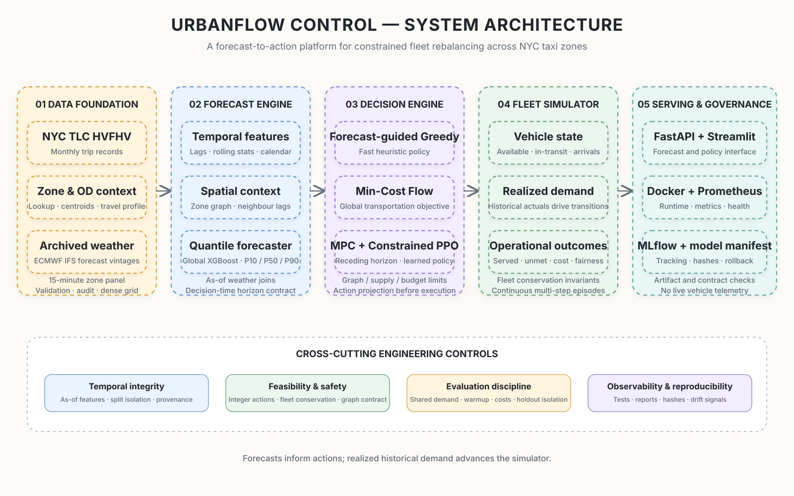
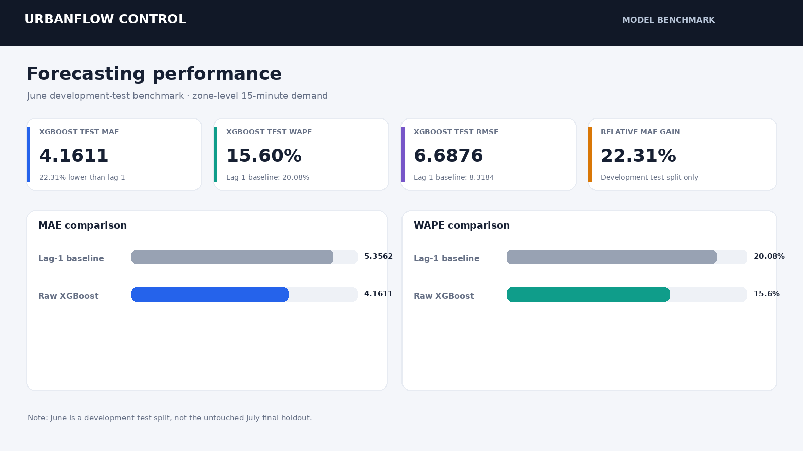
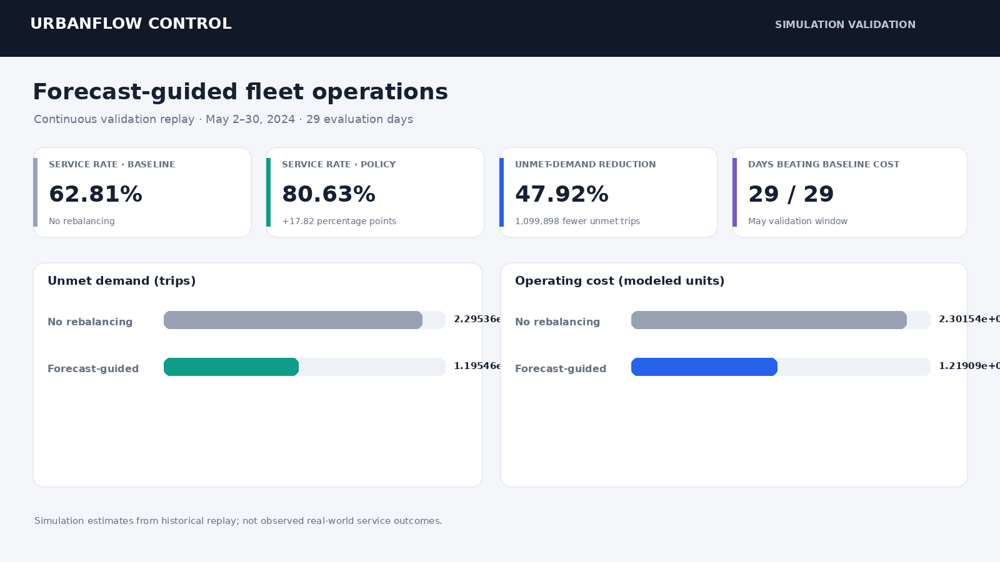
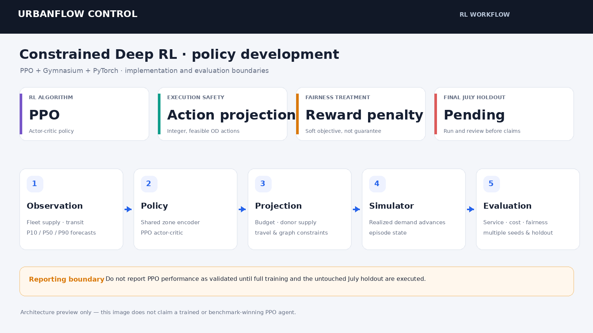
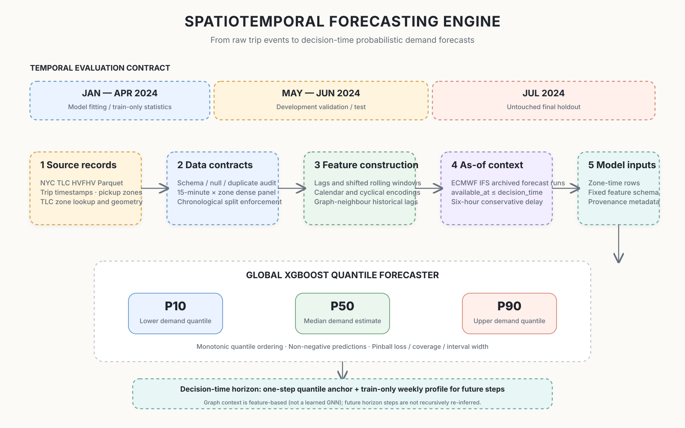
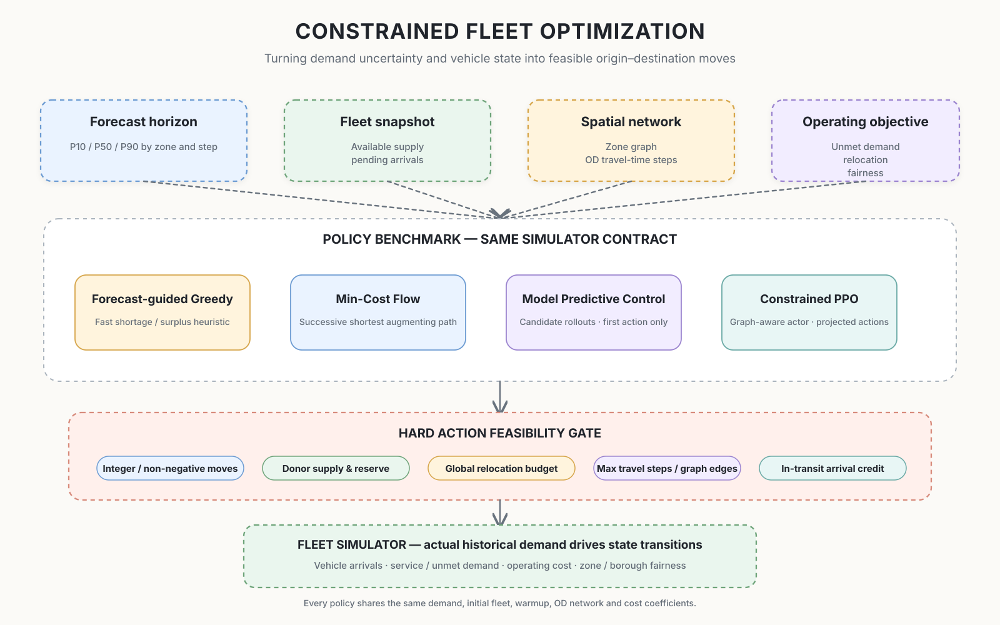
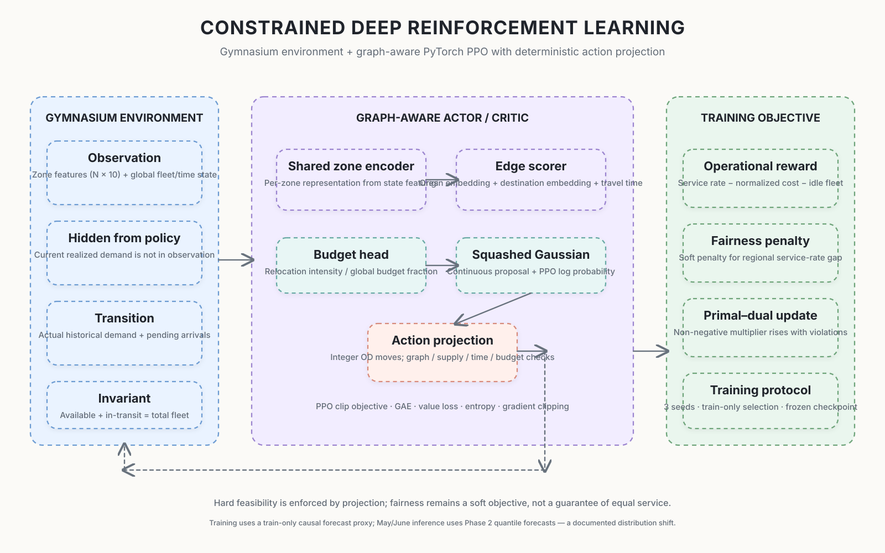
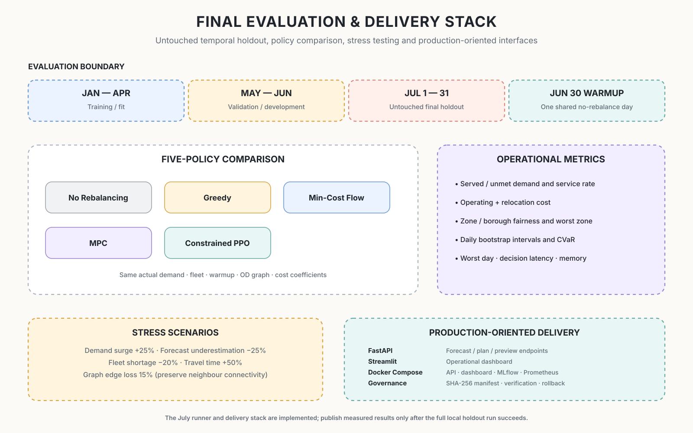

# UrbanFlow Control

**Forecast-aware fleet rebalancing for NYC ride-hailing — from spatiotemporal demand prediction to constrained operational decisions.**

[](https://www.python.org/)
[](LICENSE)
[](#spatiotemporal-forecasting)
[](#optimization-engine)
[](#constrained-deep-reinforcement-learning)

UrbanFlow Control is an end-to-end research and engineering system that converts historical mobility data into **decision-time demand forecasts**, then uses those forecasts to construct and evaluate fleet-rebalancing actions under spatial, temporal, fleet and operating-cost constraints.

The system combines a leakage-aware data pipeline, graph-enhanced probabilistic forecasting, a discrete-event fleet simulator, mathematical optimization, constrained Deep Reinforcement Learning, and a production-oriented API/monitoring layer.

> **Scope and evidence note** — This repository contains the implementation and reproducible workflows for the five development phases. The deterministic XGBoost benchmark below is a completed Jan–Jun 2024 development result. The July 2024 final holdout is deliberately separate: do not claim final five-policy or PPO performance until `scripts/run_final_holdout.py` has completed locally and its report has been reviewed. Simulator metrics are modeled estimates, not observed real-world service outcomes.

---

## System overview



### What the system does

1. Ingests and validates NYC TLC High Volume For-Hire Vehicle (HVFHV) trip records.
2. Builds a dense 15-minute pickup-demand panel for each eligible taxi zone.
3. Generates leakage-safe temporal, weather-vintage and graph-neighbour features.
4. Produces probabilistic demand forecasts (`P10`, `P50`, `P90`) and decision-time horizon inputs.
5. Converts forecasted demand and current fleet state into feasible relocation plans.
6. Replays policies in a simulator whose transitions use realized historical demand.
7. Compares operational outcomes and exposes forecasting/planning services through an API and dashboard.

## Architecture at a glance

| Layer | Main components | Responsibility |
|---|---|---|
| Data engineering | Polars, PyArrow, DuckDB, TLC validation | Auditable trip ingestion, dense zone-time aggregation and data contracts |
| Forecasting | XGBoost, quantile loss, temporal features | Zone-level demand distributions and multi-step decision-time forecasts |
| Spatial context | TLC zone geometry, weighted k-nearest-neighbour graph | Neighbour-lag features and graph-constrained relocation feasibility |
| Optimization | Greedy, Min-Cost Flow, MPC | Feasible vehicle redistribution under supply, travel and cost constraints |
| Deep RL | Gymnasium, PyTorch PPO, action projection | Learned policy with hard action feasibility and a soft fairness objective |
| Simulation | Fleet state, OD profile, travel-time steps | Consistent multi-step replay using realized historical demand |
| Delivery & MLOps | FastAPI, Streamlit, Docker, MLflow, Prometheus | Serving interfaces, health/metrics, experiment tracking and artifact governance |

---

## Dashboard previews

The following static dashboard previews summarize the recorded development benchmark and the documented decision workflow. They are generated for repository documentation and do not require running the application. The forecasting panel reflects the June development-test benchmark; the simulation panel reflects the May 2–30 historical replay. The Deep RL panel is an architecture/readiness view, **not a claim of completed PPO performance**.







---

## Data foundation

The primary demand source is the NYC Taxi & Limousine Commission's monthly **HVFHV trip-record dataset**. The original Jan–Jun 2024 forecasting panel contains:

| Dataset property | Value |
|---|---:|
| Historical period | Jan–Jun 2024 |
| Recorded pickup events | 120,859,803 |
| TLC taxi zones in the dense panel | 262 |
| Temporal resolution | 15 minutes |
| Dense zone-interval rows | 4,576,616 |

The pipeline validates source schemas and timestamps, audits invalid/duplicate records, aggregates pickups by `zone_id × interval_start`, and materializes zero-demand zone intervals. Simulation inputs separately define the fit-eligible zone set, zone ordering, OD profile and historical demand panel.

**Primary data sources**

- [NYC TLC Trip Record Data](https://www.nyc.gov/site/tlc/about/tlc-trip-record-data.page)
- [Open-Meteo Single Runs API](https://open-meteo.com/en/docs/single-runs-api) for archived ECMWF IFS forecast vintages.

## Spatiotemporal forecasting



### Temporal feature contract

The forecasting stack includes lagged demand, shifted rolling statistics, calendar encodings and zone identity. Rolling features are shifted so the target interval cannot contribute to its own inputs. Chronological splits are used; the final holdout is not used for model or policy selection.

### Weather and spatial context

- Weather features are joined from archived ECMWF IFS forecast runs using an explicit availability timestamp. A conservative six-hour publication delay is applied; a run is eligible only when `available_at <= decision_time`.
- Weather archive coverage begins on 2024-03-14. Earlier intervals retain a missing-weather indicator rather than being filled with future observations or reanalysis.
- The taxi-zone graph is derived from official zone centroids using a symmetric, distance-weighted k-nearest-neighbour construction.
- Graph information enters the forecaster through neighbour-lag and neighbourhood-context features. **This is graph-enhanced global XGBoost, not a Graph Neural Network (GNN).**

### Probabilistic outputs

Three global XGBoost quantile models produce `P10`, `P50` and `P90` demand estimates. The pipeline checks finite/non-negative outputs and quantile ordering, and reports pinball loss, empirical coverage and interval width.

The decision-time horizon builder uses the one-step quantile forecast as an anchor and a train-only weekly profile for future horizon steps. It does not use future realized demand or offline predictions whose lag features would have access to future observations. Horizon steps beyond the anchor are **profile-based projections**, not recursively re-inferred model forecasts with a fresh weather vintage at every step.

## Optimization engine



The policy layer consumes a common contract:

- Decision-time `P10/P50/P90` demand horizon by zone.
- Available vehicles and scheduled in-transit arrivals.
- Zone adjacency and OD travel-time steps.
- Relocation budget, donor reserve, cost and fairness settings.

Implemented policy families:

- **Forecast-guided Greedy** — fast shortage/surplus-based relocation heuristic.
- **Min-Cost Flow** — successive-shortest-augmenting-path transportation solver with explicit unserved-demand economics.
- **Model Predictive Control (MPC)** — candidate-based receding-horizon evaluation; only the first action is executed before replanning.
- **No Rebalancing** — operational reference policy.

Hard action constraints include integer/non-negative moves, available donor supply, relocation budget, maximum travel steps, graph-edge feasibility and credit for in-transit vehicles. The benchmark is designed so policies share the same demand, initial fleet, warmup, OD/network and cost contracts.

## Constrained Deep Reinforcement Learning



The RL implementation uses a custom **Gymnasium** fleet-rebalancing environment and a **PyTorch PPO** learner. The actor uses a shared zone encoder, an edge scorer informed by origin/destination representations and travel time, and a separate relocation-budget head. Continuous proposals are converted into integer OD actions by a deterministic projection layer before the simulator executes them.

The environment observation includes zone-level supply, in-transit vehicles, forecast quantiles, uncertainty and historical service context. The current realized demand is not exposed to the policy observation; the simulator uses actual historical demand to advance the episode.

The reward combines service, normalized operating cost, idle fleet and a primal-dual penalty for regional service-rate disparity. **Feasibility is hard-enforced by action projection; fairness is a soft objective, not a guarantee of equal service rates.**

### RL training/evaluation boundary

The supplied Phase 4 design trains three PPO seeds on Feb–Apr training episodes and selects a checkpoint using training rollouts only. Due to the absence of historical out-of-fold quantile forecasts for the training period, the training environment uses a documented train-only causal lag-1 seasonal proxy with an uncalibrated uncertainty augmentation. May/June inference uses the Phase 2 archived quantile forecasts. This creates a known training-to-inference distribution shift and should be considered when interpreting PPO results.

The Phase 4 source documentation states that large-data NYC PPO training and the May comparison must be executed in the project environment before measured RL performance is claimed. A source implementation or synthetic unit test is not evidence of a successfully trained, validated agent.

## Simulation and final evaluation



The fleet simulator models zone-level available and in-transit vehicles, passenger trips, relocation trips, delayed arrivals, unmet demand, idle supply and operating costs. Core invariants include fleet conservation and `served + unmet = realized demand`.

The final evaluation protocol reserves **July 1–31, 2024** as an untouched temporal holdout, with June 30 used as a single shared no-rebalancing warmup. The simulator carries fleet state continuously across the July episode; it is not reset each day. The intended comparison includes five policies: No Rebalancing, Greedy, Min-Cost Flow, MPC and the frozen train-selected Constrained PPO checkpoint.

The final report is designed to include aggregate and daily service/cost metrics, zone and borough fairness, worst-day outcomes, bootstrap intervals, service-rate and cost CVaR, decision latency and process memory. Bootstrap samples are daily aggregates from a stateful episode and are temporally dependent; intervals are descriptive, not independent-day guarantees.

### Stress scenarios

The stress suite includes demand surge (+25%), forecast underestimation (−25%), fleet shortage (−20%), travel-time disruption (+50%) and graph edge loss (15%, preserving at least one neighbour per zone). The current stress runner compares the four Phase 3 optimization policies; it does not claim PPO stress robustness.

## Historical forecasting benchmark

The repository includes a completed deterministic XGBoost benchmark on the Jan–Jun 2024 panel. The reported `test` split is the June development-test period and has already been inspected; it is **not** the untouched July final holdout and is not a result for the later all-zone weather/quantile pipeline.

| Metric | Lag-1 baseline | Raw XGBoost |
|---|---:|---:|
| MAE | 5.3562 | **4.1611** |
| RMSE | 8.3184 | **6.6876** |
| WAPE | 20.08% | **15.60%** |

Raw XGBoost reduced MAE by **22.31%** relative to the lag-1 baseline on that development-test split. The optional constrained low-demand calibration changed MAE only slightly and did not improve RMSE; it should not be presented as a universally superior model. See `reports/forecasting/2024-01_2024-06-final-model-comparison.json` for the exact comparison and segment summaries.

**No July five-policy operational result is published in this README.** Generate and review `reports/evaluation/2024-07-final-holdout.json` before adding final operational performance claims.

## Reproducibility

### Environment

Python 3.11+ is required. From the repository root:

```bash
python -m venv .venv
source .venv/bin/activate
python -m pip install --upgrade pip
python -m pip install -e '.[dev,rl,api,dashboard,mlops]'
```

### Quality checks

```bash
ruff check src scripts dashboards tests
pytest -q
```

### Build the July forecasting and simulation inputs

This workflow downloads monthly TLC Parquet files and archived weather vintages; allow sufficient disk space and network time.

```bash
make build-july
```

The target builds the multi-month demand panel, forecasting features, simulation inputs, zone centroids/graph, as-of weather features, quantile models and decision-time horizon forecasts.

### Train the Phase 4 PPO checkpoint (if it is not already available)

```bash
python scripts/train_constrained_ppo.py \
  --config configs/rl/constrained_ppo.yaml
```

This must remain a train-only selection workflow. Do not use July labels to select PPO seeds, rewards or hyperparameters. The final-holdout runner expects the promoted train-selected checkpoint and its training report.

### Run the untouched final holdout

```bash
make final-holdout
```

Equivalent command:

```bash
python scripts/run_final_holdout.py \
  --config configs/evaluation/final_holdout_july.yaml
```

The runner fails closed if the dense July panel, warmup, decision-time forecasts, quantile provenance, frozen PPO checkpoint hash or shared policy contracts do not satisfy the evaluation protocol.

### Run stress scenarios

```bash
make stress
```

### Reports and artifacts

Generated Parquet data, model checkpoints and large reports are intentionally local artifacts and are not required to be committed to Git. The final report and supporting artifacts are written under `reports/evaluation/`.

## Serving and operations

### Docker Compose

```bash
cp .env.example .env
# Set a long random URBANFLOW_API_KEY in .env before exposing the API.
docker compose up --build -d
docker compose ps
```

Local services:

| Service | Default URL | Purpose |
|---|---|---|
| FastAPI | `http://localhost:8000` | Forecast, plan and simulation-preview endpoints |
| Streamlit | `http://localhost:8501` | Operational dashboard |
| MLflow | `http://localhost:5000` | Experiment/report tracking |
| Prometheus | `http://localhost:9090` | API metrics |

API endpoints include `/health`, `/ready`, `/metrics`, `/v1/models/current`, `/v1/zones`, `/v1/zones/{zone_id}/status`, `/v1/demand/forecast`, `/v1/rebalancing/plan` and `/v1/scenarios/simulate`.

The model manifest records SHA-256 hashes for model files, metadata and graph artifacts; verification and rollback scripts are provided. Monitoring includes train-reference PSI and should be paired with residual, service-level and action-distribution monitoring.

## Known limitations and interpretation

- TLC completed-trip records are a proxy for demand; they do not provide live requests, live driver supply or observed wait times.
- OD probabilities and travel-time steps are estimated from historical trips; they are not live traffic measurements.
- The zone graph is centroid-based and feature-oriented; it is not a learned GNN.
- Multi-step quantile horizons beyond the one-step anchor use a train-only weekly profile.
- PPO training uses a causal training proxy while evaluation uses archived quantile forecasts; this distribution shift must be reported.
- Fairness is partly a soft objective. Hard feasibility does not imply equal service across all zones or boroughs.
- The API accepts a caller-supplied fleet snapshot. It is not connected to a live dispatch system, driver app or vehicle telemetry feed.
- The dashboard uses zone centroids for visual context, not full taxi-zone polygon boundaries.
- Docker Compose, MLflow and Prometheus provide local deployment infrastructure; shared production use still requires TLS, hardened authentication, rate limits, durable storage, secrets management and operational alerting.

## Repository map

```text
src/urbanflow/
  data/           ingestion, validation, aggregation, weather inputs
  forecasting/   temporal features, XGBoost, quantile forecasting
  geo/            taxi-zone graph construction
  simulation/     fleet simulator and forecast-guided policy
  optimization/   Min-Cost Flow and MPC
  rl/             Gymnasium environment, PPO and action projection
  evaluation/     forecast and operational error analysis
  api/            FastAPI service and schemas
  monitoring/     drift reports and model manifest controls

configs/          data, forecasting, weather, simulation, RL and evaluation configs
scripts/          reproducible build, training, benchmark and release workflows
dashboards/        Streamlit operations dashboard
docs/             data contracts, evaluation protocol, phase runbooks
reports/          tracked lightweight reports; generated large outputs are local
```

## License

This project is released under the [MIT License](LICENSE).
